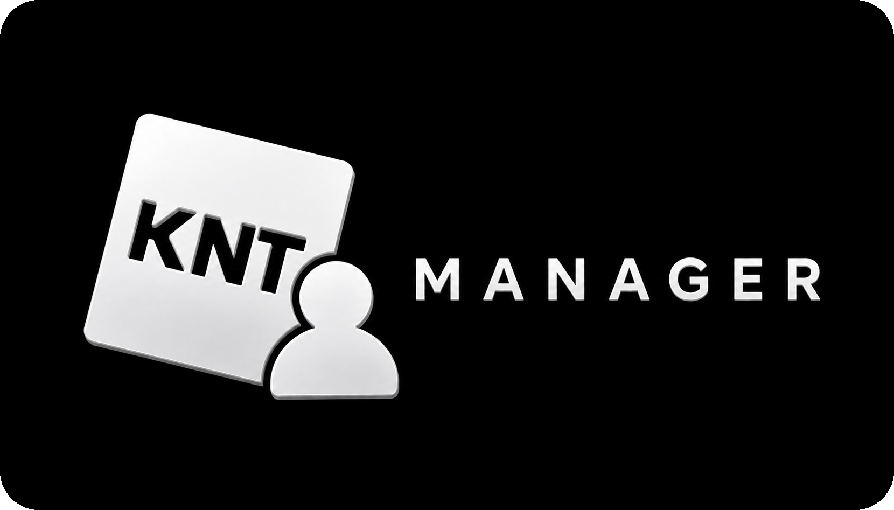

<p align="center">
  
</p>

<p align="center">
  <b>Run multiple Roblox accounts side by side — one clean dashboard.</b><br/>
  <sub>A modern, feature-rich fork of MultiRoblox built with Tauri 2.</sub>
</p>

<p align="center">
  
  
  
  
</p>

---

## ✨ Features

- 🖥️ **Multi-instance** — launch as many Roblox clients as you want, simultaneously
- 👤 **Account manager** — add, edit, organize and favorite accounts with inline renaming
- 🗂️ **Groups & categories** — launch whole teams of accounts into the same game with one click
- 🔒 **Local encryption** — accounts are stored encrypted (AES-256-GCM via scrypt, or Windows DPAPI), protected by your own key
- 🟡 **Home (tray) detection** — knows when an account lives in the Roblox system tray and tracks it
- ⚡ **Process control** — reliable Sync, Kill All, per-account kill, RAM trim and FPS control
- 📊 **Live dashboard** — real-time stats, running instances and recent activity
- 🎨 **Theme engine** — 12 built-in themes with unique background textures (grain, stars, rays, hexagons…), custom themes, and full accent/border customization
- 🔁 **Auto AFK** — keeps instances alive against the idle kick
- 🧪 **Alt generator** — BloxGen / Altgen API integration plus a free manual generator with real-time Roblox username validation
- 📈 **Tracking** — monitor your accounts and games
- 📦 **Manual backups** — password-protected, restorable on any PC
- 🌐 **i18n** — Portuguese (BR) and English

## 🖼️ Screenshots

*Coming soon.*

## 📥 Installation

1. Grab the latest **`KNT-Manager.exe`** from the [Releases](../../releases) page
2. Run it — no installer needed, portable
3. Windows 10/11 with **WebView2** runtime (usually preinstalled)

The desktop app stores its data under `%APPDATA%\multiroblox`. Account cookies and passwords are encrypted locally; session cookies are sent to Roblox to authenticate requests. Optional account generators and Discord tracking contact their respective services.

The browser demo stores account data in plain `localStorage`. Generator API keys and manually generated credentials also use WebView `localStorage` in the desktop app; moving these secrets into encrypted storage is pending. See the [review and test guide](docs/REVIEW-ROUND-1.pt-BR.md) for confirmed limitations.

Password changes now verify accounts and generation history before committing the encrypted files and settings through a recovery journal. Interrupted changes are recovered before startup reads. See the [persistence review and test guide](docs/ROUND-3-PERSISTENCE.pt-BR.md) for scope, checks, and remaining limitations.

The Grafite interface shares styles and dialog behavior across all internal pages. Fonts and icons are bundled locally; existing themes and account views remain available. See the [UI changes and test guide](docs/ROUND-4-UI.pt-BR.md) for validation and desktop testing steps.

The workspace layout now uses an account table, group catalog/detail pane, settings navigation and a Tools hub. These structural changes apply to every theme. See the [layout changes and desktop test guide](docs/ROUND-5-LAYOUT.pt-BR.md).

## 🛠️ Building from source

Requirements: Windows 10/11, [Rust](https://rustup.rs) stable (MSVC toolchain, Visual Studio C++ Build Tools and Windows SDK), and the .NET Framework C# compiler (`%WINDIR%\Microsoft.NET\Framework64\v4.0.30319\csc.exe`) for the native helper. Node.js 22+ is used for the web demo, JavaScript tests and optional Tauri CLI.

```bat
build.bat
```

That produces `dist\KNT-Manager.exe`. The frontend lives in `src/` and is embedded at compile time — rebuild after any UI change.

## Development checks

JavaScript tests need no npm dependencies. Run from the repository root:

```powershell
npm test
npm run web:build
& "$env:WINDIR\Microsoft.NET\Framework64\v4.0.30319\csc.exe" /nologo /optimize+ /platform:x64 /target:exe /r:System.Drawing.dll /out:src-tauri\resources\RobloxNative.exe src-tauri\resources\RobloxNative.cs
cargo check --locked --all-targets --manifest-path src-tauri/Cargo.toml
cargo test --locked --lib --manifest-path src-tauri/Cargo.toml
```

The C# resource must exist **before** Rust compilation (`include_bytes!` embeds it). HTTP tests use local fixtures and fake session strings. The Windows CI workflow runs these checks without publishing or deploying the app.

Roblox requests made by the desktop backend share one queue, at least 250 ms between starts, a 10-second request timeout, and an 8 MiB response limit. HTTP 429 pauses all these requests using `Retry-After` (seconds or HTTP date), or exponential cooldown starting at 30 seconds when absent. HTTP 401 stops reuse of that session until it is replaced or the app restarts. Authentication denials/security challenges pause authenticated requests for that session for 15 minutes; a resource permission error alone does not suspend the session. Authentication POSTs are not automatically retried except once for an explicit CSRF refresh.

These are conservative application controls, **not documented Roblox quotas**. They currently apply to the desktop Roblox API layer; the separate browser relay and third-party integrations still need equivalent scheduling. No reduction in actual account-blocking incidence has been measured.

## 📁 Project structure

```
├─ src/              # Frontend (vanilla JS, HTML, CSS, i18n)
├─ src-tauri/        # Rust backend (process control, encryption, backups)
│  └─ src/
│     ├─ native.rs   # Roblox process management (sync, kill, watch)
│     ├─ encryption.rs # AES-256-GCM / DPAPI storage
│     ├─ backup.rs   # Password-protected backups
│     └─ ...
├─ web/              # Browser demo (mirrors the UI)
├─ site/             # Landing page
└─ build.bat         # One-command build
```

## 🤝 Credits

**KNT Manager** is a fork of the original [MultiRoblox](https://github.com/PookiePepelsss/MultiRoblox-RAM) project, rebuilt and extended by:

| | |
|---|---|
| **pookiepepelss** | Lead Developer |
| **xern** | Co-Developer |

## ⚠️ Disclaimer

This tool automates Roblox clients. Automated multi-account usage may violate Roblox's Terms of Service — **use at your own risk**. This project is not affiliated with or endorsed by Roblox Corporation. All trademarks belong to their respective owners.

## 📄 License

[MIT](LICENSE)
